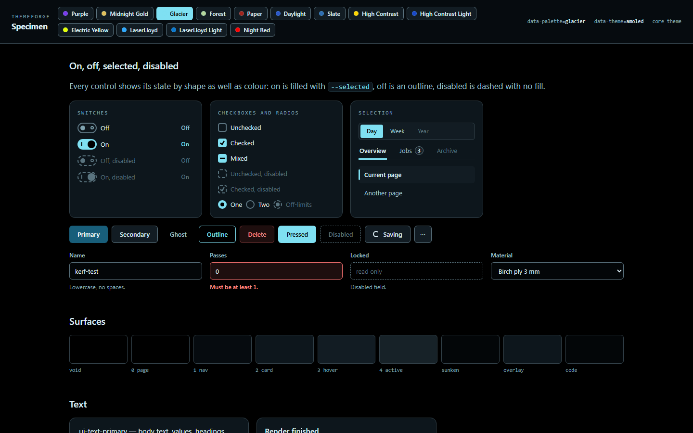
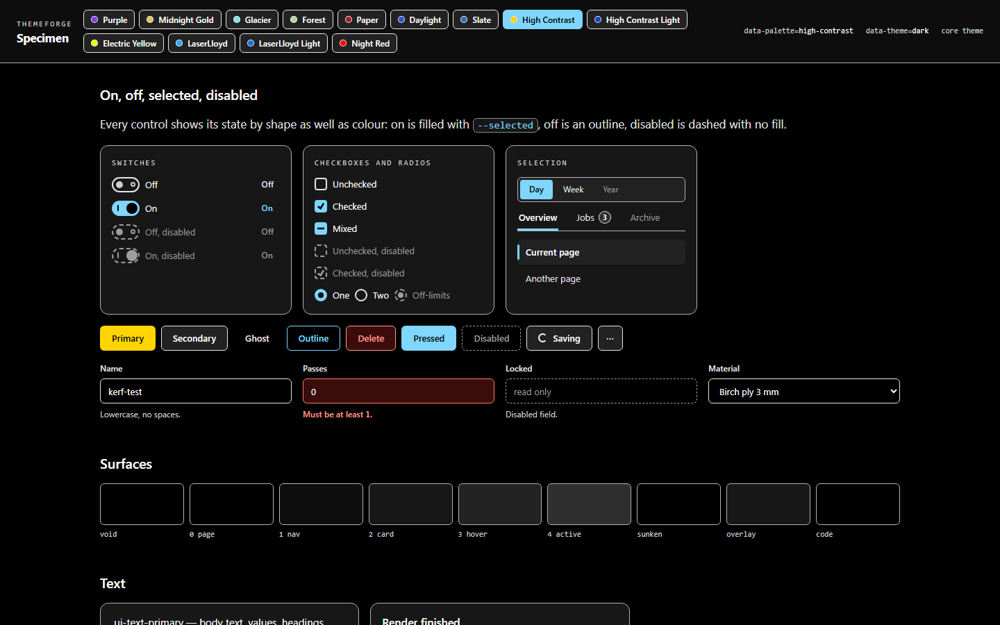
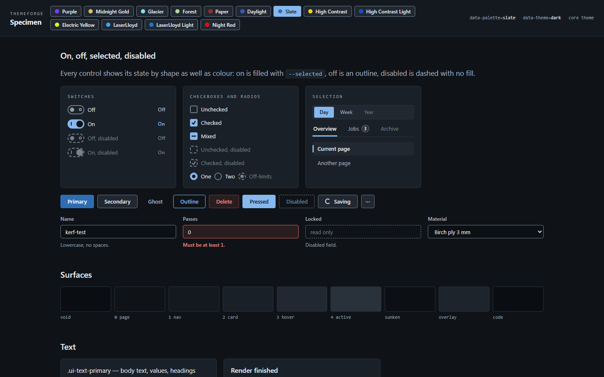
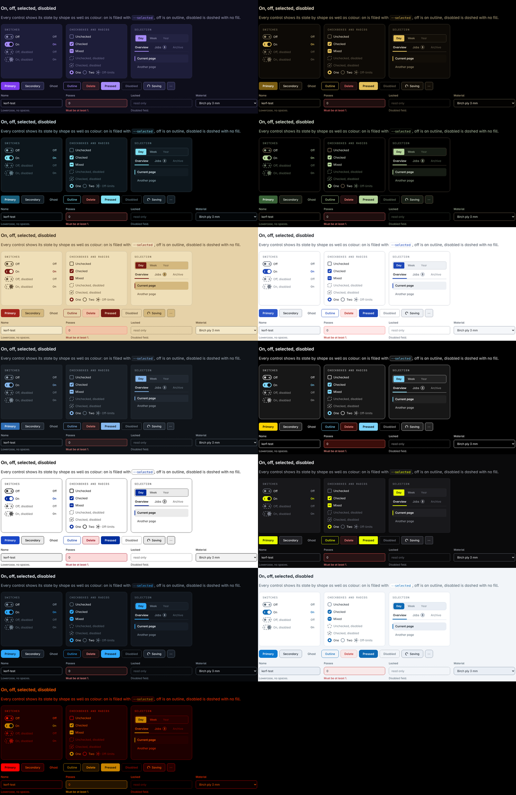
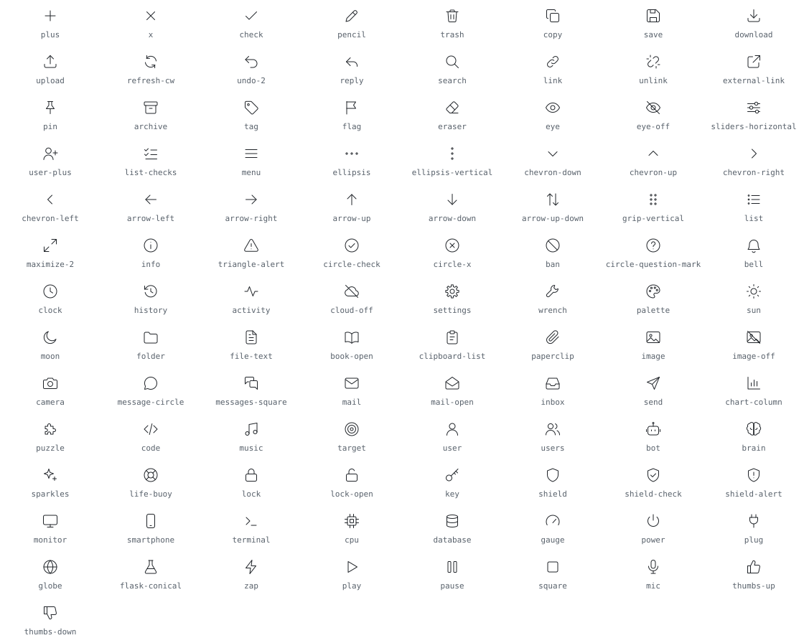
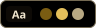
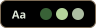

# ThemeForge

<p align="center">
  
  <br><sub>The specimen board in the Glacier theme: every control and surface token, with the theme picker along the top.</sub>
</p>

<table>
  <tr>
    <td width="50%"><br><sub>High Contrast: the same components with a yellow primary and heavier outlines.</sub></td>
    <td width="50%"><br><sub>Slate: a neutral grey-blue theme from the same tokens.</sub></td>
  </tr>
</table>

ThemeForge is a drop-in CSS theme system for web apps that an AI coding agent installs in
one step: thirteen colour themes (dark, OLED black, light, a neutral default and a high-contrast
pair, with automatic dark mode from the OS setting), a theme picker, design tokens, a base element layer, text standards,
ready-made component classes and 105 outline icons that take the theme's colours. MIT-0 licensed: use it any way you like, nothing to credit or keep. Plain CSS and a small script in one folder,
`ui-theme/`. No build step, no dependencies, any framework. The Python package is the
**`themeforge`** distribution (a wheel; you `import forgeui` and run `python -m forgeui`), installed from the git
release tag until it is published on PyPI; the repository, the `ui-theme/` folder and every token and class keep
the ThemeForge names, so nothing an app depends on changes with the name.



See every component in every theme in [`specimen/index.html`](specimen/index.html) (serve the
repository with `python3 -m http.server` and open `/specimen/`).

**Using an AI agent?** Point it at [`AGENTS.md`](AGENTS.md): "Add ThemeForge to this app
following AGENTS.md in https://github.com/LaserLloyd/ThemeForge". Or hand it the release zip,
which holds the folder, `AGENTS.md`, the docs, tokens and examples in one download:
**[ThemeForge.zip](https://github.com/LaserLloyd/ThemeForge/releases/latest/download/ThemeForge.zip)**
(always the newest release; each one is also on the
[releases page](https://github.com/LaserLloyd/ThemeForge/releases) as `ThemeForge-<version>.zip`).
Tell it: "Unzip ThemeForge.zip and add the theme to this app following its AGENTS.md."

## Icons, not emoji

Emoji used as icons look cheap and ignore the theme. The folder carries 105 outline icons
(drawn for ThemeForge, MIT-0 like the rest) in one sprite: the ones the LaserLloyd
apps (DisPatch, MailForge, StudioForge, ChatForge, CrucibleForge and the rest) use. They take the
text colour and the theme's stroke weight, so every theme has the same set in its own colours,
and the high-contrast pair draws them heavier:



```html
<button class="ui-btn"><svg class="ui-icon" aria-hidden="true"><use href="/static/ui-theme/icons.svg#trash"/></svg>Delete</button>
```

`UIComponents.iconFor('🗑️')` returns `'trash'`: 263 emoji and symbols are mapped, so an app that
used emoji can switch mechanically. NiceGUI apps keep their Material names (223 are mapped):
`ui.button(icon=forgeui.quasar_icon('delete_forever'))` draws `trash`. Emoji people type stay
emoji, drawn one of three ways: as the icon (`emojify(el, 'icon')`), in the text colour (`'text'`),
or in their own colours (`'color'`). Names, both maps and the styles: [`docs/ICONS.md`](docs/ICONS.md).

## Install

ThemeForge is a package you add to your own web app, not a program you run. Pick your platform below; in each,
method 1 is the simplest. "Installing" means putting the `ui-theme/` folder into your app, then linking it from your pages.

Ports: none for the package. Only the optional Docker specimen preview listens, on host port 8185 (container port 8080).

### Windows

Run the blocks in PowerShell. After a `winget install`, close and reopen PowerShell so the new program is on `PATH`.

#### 1. One-line installer, `update.py` (simplest)

Choose this when you want the folder in your app and nothing else: it needs Python 3.9 or newer, no git, no pip.

```powershell
winget install --id Python.Python.3.12 -e --source winget
# close and reopen PowerShell, then go to your app's root folder:
cd C:\path\to\your\app
py -3 -c "import urllib.request as u,sys;sys.argv=['update.py','--dest','static/ui-theme'];exec(u.urlopen('https://raw.githubusercontent.com/LaserLloyd/ThemeForge/main/ui-theme/update.py').read())"
Get-Content static\ui-theme\VERSION     # prints: ThemeForge <version> <hash>
```

| Pros | Cons |
|---|---|
| One command after Python; works for any framework | No manifest, so no `--check` for CI (use method 2 for that) |
| Checks every file against `files.json` before writing | Fetches from GitHub on each run; offline needs `--source` |
| Later updates: `py -3 static\ui-theme\update.py` | Installs the latest release; pin with `--ref vX.Y.Z` |

#### 2. Python package, `forgeui.json` + `python -m forgeui vendor`

Choose this for a Python app (FastAPI, NiceGUI, Flask, Django) or when CI should fail if the copy drifts. The `themeforge` package installs from the
git release tag until it is published on PyPI. It needs git.

```powershell
winget install --id Git.Git -e --source winget
winget install --id Python.Python.3.12 -e --source winget
# close and reopen PowerShell, then:
cd C:\path\to\your\app
py -3 -m venv .venv
.\.venv\Scripts\python.exe -m pip install "themeforge @ git+https://github.com/LaserLloyd/ThemeForge@v2.0.0"
.\.venv\Scripts\python.exe -m forgeui init --dest static/ui-theme    # writes forgeui.json
.\.venv\Scripts\python.exe -m forgeui vendor                         # copies the folder, verified
.\.venv\Scripts\python.exe -m forgeui vendor --check                 # prints ok, exit 0
```

| Pros | Cons |
|---|---|
| `forgeui.json` records version, themes and overlays in your repo | Needs git and a venv |
| `vendor --check` exits 1 on drift: use it in CI or a unit test | Not on PyPI yet, so the install line is a long git URL |
| Python helpers: `forgeui.mount(app, ...)`, `head_html_from_manifest(...)` | The tag must exist: if pip reports it cannot find `v2.0.0`, use the `update.py` route until the release is tagged |

#### 3. `uv`, no venv to manage

Choose this when you already use [uv](https://docs.astral.sh/uv/). `uvx` runs the `forgeui` command from a cached environment, so nothing is installed into your app.

```powershell
winget install --id Git.Git -e --source winget
winget install --id astral-sh.uv -e --source winget
# close and reopen PowerShell, then:
cd C:\path\to\your\app
$f = "themeforge @ git+https://github.com/LaserLloyd/ThemeForge@v2.0.0"
uvx --from $f forgeui init --dest static/ui-theme
uvx --from $f forgeui vendor
uvx --from $f forgeui vendor --check
```

| Pros | Cons |
|---|---|
| No venv, no `pip`, no activation step | You need uv, and git for the first fetch |
| The pinned tag in `$f` is the only version you manage | `forgeui.mount()` in code still needs the package in your app's own environment |

#### 4. Docker Desktop, specimen preview only

Choose this to look at every component in every theme before adopting it. It does not install anything into your app.

```powershell
winget install --id Git.Git -e --source winget
winget install --id Docker.DockerDesktop -e --source winget
# start Docker Desktop once and wait until it says the engine is running, then:
git clone https://github.com/LaserLloyd/ThemeForge.git
cd ThemeForge
docker compose -f deploy/compose/compose.yml up -d
curl.exe -s http://127.0.0.1:8185/healthz     # prints: ok
# open http://127.0.0.1:8185/  (redirects to /specimen/)
```

| Pros | Cons |
|---|---|
| Nothing to install into your app; isolated, read-only, non-root container | Docker Desktop is a large install and needs virtualisation enabled |
| Stateless: `down -v` cannot lose anything | Theme edits need `up -d --build` |

### Linux

Blocks assume Ubuntu or Debian (apt).

#### 1. One-line installer, `update.py` (simplest)

Choose this when you want the folder in your app and nothing else. A bare Ubuntu image has no `python3`, so the first line installs it.

```bash
sudo apt-get update && sudo apt-get install -y python3 ca-certificates
cd /path/to/your/app
python3 -c "import urllib.request as u,sys;sys.argv=['update.py','--dest','static/ui-theme'];exec(u.urlopen('https://raw.githubusercontent.com/LaserLloyd/ThemeForge/main/ui-theme/update.py').read())"
cat static/ui-theme/VERSION     # prints: ThemeForge <version> <hash>
```

| Pros | Cons |
|---|---|
| One command after Python; works for any framework | No manifest, so no `--check` for CI (use method 2 or 3) |
| No pip, so PEP 668 ("externally managed environment") never applies | Fetches from GitHub on each run; offline needs `--source` |
| Later updates: `python3 static/ui-theme/update.py` | Installs the latest release; pin with `--ref vX.Y.Z` |

#### 2. `uv`, no venv to manage

Choose this for a Python app when you want the manifest and drift check without creating a venv.

```bash
sudo apt-get update && sudo apt-get install -y git curl ca-certificates
curl -LsSf https://astral.sh/uv/install.sh | sh
source $HOME/.local/bin/env
cd /path/to/your/app
F="themeforge @ git+https://github.com/LaserLloyd/ThemeForge@v2.0.0"
uvx --from "$F" forgeui init --dest static/ui-theme
uvx --from "$F" forgeui vendor
uvx --from "$F" forgeui vendor --check     # prints ok, exit 0
```

| Pros | Cons |
|---|---|
| No venv, no pip, no PEP 668 error | Needs git and uv; uv must be on `PATH` (the `source` line does that for this shell) |
| `forgeui.json` records version, themes and overlays in your repo | `forgeui.mount()` in code still needs the package in your app's own environment |
| `vendor --check` exits 1 on drift | Not on PyPI yet, so the install line is a long git URL |

#### 3. `venv` + `pip`

Choose this when you cannot install uv. Ubuntu 24.04 refuses a bare `pip install` (PEP 668), so use a venv.

```bash
sudo apt-get update && sudo apt-get install -y git python3-venv
cd /path/to/your/app
python3 -m venv .venv
.venv/bin/pip install "themeforge @ git+https://github.com/LaserLloyd/ThemeForge@v2.0.0"
.venv/bin/python -m forgeui init --dest static/ui-theme
.venv/bin/python -m forgeui vendor
.venv/bin/python -m forgeui vendor --check     # prints ok, exit 0
```

| Pros | Cons |
|---|---|
| Only the standard tools; the venv is also where `forgeui.mount()` runs | Most steps of the three; needs git and `python3-venv` |
| Same manifest and drift check as method 2 | If pip cannot find tag `v2.0.0`, use method 1 until the release is tagged |

#### 4. Docker Compose, specimen preview only

Choose this to look at every component in every theme before adopting it. It does not install anything into your app.

```bash
sudo apt-get update && sudo apt-get install -y git curl docker.io docker-compose-v2
sudo usermod -aG docker $USER    # log out and in once, or prefix the docker lines below with sudo
git clone https://github.com/LaserLloyd/ThemeForge.git
cd ThemeForge
docker compose -f deploy/compose/compose.yml up -d
curl -s http://127.0.0.1:8185/healthz     # prints: ok
# open http://127.0.0.1:8185/  (redirects to /specimen/)
```

| Pros | Cons |
|---|---|
| Nothing to install into your app; isolated, read-only, non-root container | Needs a Docker engine and about 60 MB of image |
| Stateless: `down -v` cannot lose anything | Theme edits need `up -d --build` |

### macOS

Use Terminal; the package is plain Python and CSS, so nothing is macOS-specific. Python 3 and git come with the Xcode command line tools.

#### 1. One-line installer, `update.py` (simplest)

```bash
xcode-select --install     # skip if python3 and git already work; accept the dialog, wait, then continue
cd /path/to/your/app
python3 -c "import urllib.request as u,sys;sys.argv=['update.py','--dest','static/ui-theme'];exec(u.urlopen('https://raw.githubusercontent.com/LaserLloyd/ThemeForge/main/ui-theme/update.py').read())"
cat static/ui-theme/VERSION     # prints: ThemeForge <version> <hash>
```

| Pros | Cons |
|---|---|
| One command after Python; works for any framework | No manifest, so no `--check` for CI |
| Later updates: `python3 static/ui-theme/update.py` | The Python from the command line tools can be old; it must be 3.9 or newer (`python3 --version`) |

#### 2. `uv`

```bash
xcode-select --install     # skip if git already works
curl -LsSf https://astral.sh/uv/install.sh | sh
source $HOME/.local/bin/env
cd /path/to/your/app
F="themeforge @ git+https://github.com/LaserLloyd/ThemeForge@v2.0.0"
uvx --from "$F" forgeui init --dest static/ui-theme
uvx --from "$F" forgeui vendor
uvx --from "$F" forgeui vendor --check     # prints ok, exit 0
```

| Pros | Cons |
|---|---|
| No venv, no pip; manifest and drift check | Needs git and uv |

#### 3. Docker Desktop, specimen preview only

```bash
brew install --cask docker     # then open Docker Desktop once and wait for "Engine running"
git clone https://github.com/LaserLloyd/ThemeForge.git
cd ThemeForge
docker compose -f deploy/compose/compose.yml up -d
curl -s http://127.0.0.1:8185/healthz     # prints: ok
```

| Pros | Cons |
|---|---|
| Nothing installed into your app | Docker Desktop is a large install |

### Upgrade and uninstall

<!-- install:start -->
Run from the app's root folder (Python 3.9 or newer; change `static/ui-theme` to the folder
you chose):

```
python3 -c "import urllib.request as u,sys;sys.argv=['update.py','--dest','static/ui-theme'];exec(u.urlopen('https://raw.githubusercontent.com/LaserLloyd/ThemeForge/main/ui-theme/update.py').read())"
```

On Windows use `python` (or `py`) instead of `python3`; the line is the same in PowerShell,
cmd and bash. It downloads the installer, which fetches the latest release from GitHub,
checks every file against its checksum list and writes the folder. Later updates are
`python3 static/ui-theme/update.py`. Offline: download a release archive (`.tar.gz`) elsewhere,
then run `python3 update.py --source <archive> --dest static/ui-theme` with the `update.py` from
its `ui-theme/` folder. If you were handed `ThemeForge.zip` (the release zip), unzip it and copy its
`ui-theme/` folder into the app, or run
`python3 ThemeForge-<version>/ui-theme/update.py --source ThemeForge-<version>/ui-theme --dest static/ui-theme`.
<!-- install:end -->

- **`update.py` route:** `python3 static/ui-theme/update.py` updates; `--check` reports only (exit 1 when an update exists);
  `--ref vX.Y.Z` pins a release. To roll back, run it again with `--ref` set to the release you had (the
  `VERSION` file of a copy names it). To uninstall, delete the `static/ui-theme` folder and the theme lines in your pages.
- **Python package route:** raise the tag in the install line (for example `@v2.0.0` to a later release), then run `vendor` again;
  `vendor --check` confirms the copy. To roll back, install the earlier tag, set `forgeui.json`'s `version` to it, and
  `vendor` again. A hand-edited bundle file is refused unless you pass `--force`, so keep edits in overlays
  (`extra_files`). To uninstall, delete the vendored folder and `forgeui.json`, and `.venv` if you made one for this.
- **Docker preview:** `git pull && docker compose -f deploy/compose/compose.yml up -d --build` updates it;
  `docker compose -f deploy/compose/compose.yml down` removes it. Nothing is stored, so there is no data to back up.

Preview settings (optional, in `deploy/compose/.env`): `HOST_PORT` (8185), `BIND_ADDR` (127.0.0.1; `0.0.0.0` publishes to your
network), `IMAGE`, `VERSION`, `MEM_LIMIT` (64m), `CPU_LIMIT` (0.5). More in [docs/deploy/docker.md](docs/deploy/docker.md);
updating details in [docs/UPDATING.md](docs/UPDATING.md). Without installing anything, a prototype can load the files from
jsDelivr: `https://cdn.jsdelivr.net/gh/LaserLloyd/ThemeForge@v2.0.0/ui-theme/ui-theme.js` (and the same path for each CSS file).

## Add it to your pages

In every page's `<head>` (change `/static/ui-theme` to the folder you chose):

```html
<script src="/static/ui-theme/ui-theme.js"
        data-themes="purple,midnight-gold,glacier,forest,paper,daylight,high-contrast,high-contrast-light"
        data-default="auto" data-default-dark="midnight-gold" data-default-light="daylight"
        data-storage-key="myapp.theme"></script>
<link rel="stylesheet" href="/static/ui-theme/ui-theme-base.css">
<link rel="stylesheet" href="/static/ui-theme/ui-components.css">
<!-- your stylesheets -->
<link rel="stylesheet" href="/static/ui-theme/ui-theme.css">
```

and a picker wherever you like: `<select data-ui-theme-picker aria-label="Theme"></select>`.
Build with tokens (`var(--surface-2)`, `var(--text-secondary)`) and classes
(`ui-btn ui-btn--primary`, `ui-card`, `ui-switch`). Full guide: [`AGENTS.md`](AGENTS.md).
Works in current Chrome, Edge, Firefox and Safari (2024 or newer).

With the `themeforge` package installed in your app's environment (Python apps), the same tags come from the manifest:

```python
import forgeui
forgeui.mount(app, "/static/ui-theme", folder="static/ui-theme")   # FastAPI or NiceGUI: serves your vendored copy (with overlays), no-cache
head = forgeui.head_html_from_manifest("forgeui.json", prefix="/static/ui-theme")   # the <head> tags
```

How the manifest, versions and overlays work: [`docs/THEME_SYSTEM.md`](docs/THEME_SYSTEM.md).

## Themes

| | Theme | Kind | |
|---|---|---|---|
|  | Purple | dark | Violet accent and soft lavender text on deep indigo. The base theme. |
|  | Midnight Gold | OLED | Warm gold on true black. |
|  | Glacier | OLED | Ice-blue text on true black with a deep teal accent. |
|  | Forest | OLED | Pale sage and lichen with bark browns on true black. |
|  | Paper | light | Warm parchment, ink-brown text, a serif for prose. |
|  | Daylight | light | Clean white with a blue accent. |
|  | Slate | dark | The neutral professional default: grey-blue, steel accent, dense but calm. |
|  | High Contrast | dark | White on black, yellow actions, 7:1 text, solid colours. |
|  | High Contrast Light | light | Black on white, blue actions, 7:1 text, solid colours. |
|  | Electric Yellow | dark, opt-in | Acid yellow on graphite. |
|  | LaserLloyd | dark, opt-in | Laser blue on graphite; pairs with LaserLloyd Light. |
|  | LaserLloyd Light | light, opt-in | The light partner of LaserLloyd. |
|  | Night Red | OLED, opt-in | Low blue light: ember text on black, zero blue in any colour. |

The first nine are the core set an app offers by default; the opt-in four appear only when an
app lists them. Every theme passes a contrast audit
([`docs/contrast-report.md`](docs/contrast-report.md)): body text at 7:1, secondary text at
4.5:1 on every surface, control edges and on/off states at 3:1. On, selected and disabled
states read by shape as well as colour in every theme. More in
[`docs/THEMES.md`](docs/THEMES.md), including how to add your own theme.

## What is in the folder

| File | |
|---|---|
| `ui-theme.js` | the runtime: applies the saved theme before first paint, follows the OS light/dark setting with `data-default="auto"`, fills pickers, syncs tabs, exposes `window.UITheme` |
| `ui-theme-base.css` | element defaults, focus ring, scrollbars, reduced motion, text tiers, `.ui-markdown`, highlight.js colours |
| `ui-components.css` | buttons, fields, checkboxes, radios, switches, cards, badges, callouts, tabs, segmented controls, tables, dialogs, menus, tooltips, toasts, progress, code blocks, an app shell |
| `ui-theme.css` | the tokens of all thirteen themes (about 20 KB gzipped) |
| `ui-components.js` | optional: themed `confirm()`, `alert()`, `prompt()` and toasts, copy-to-clipboard, inline validation, settings rows, icon and emoji helpers, translatable words (`locales/`) |
| `icons.svg`, `icons.json` | 105 outline icons in one sprite, and their names, labels, and the emoji and Material Icons names each replaces (license in `icons-LICENSE.txt`) |
| `locales/` | the words `ui-components.js` shows, in eight languages (en, ar, de, es, fr, ja, pt, zh) |
| `adapters/` | NiceGUI/Quasar, Tailwind CSS v4 and v3 |
| `update.py` | installs and updates the folder, checking every file (apps without pip); `python -m forgeui vendor` does the same from a manifest |
| `ui-theme.d.ts` | TypeScript declarations for `window.UITheme` and `window.UIComponents` |
| `themes.json`, `VERSION`, `files.json`, `README.md` | the theme list, version, checksums, and usage notes |

## Documentation

- [`AGENTS.md`](AGENTS.md): add the theme to an app, step by step (for agents and people)
- [`docs/THEME_SYSTEM.md`](docs/THEME_SYSTEM.md): the index: token contract rules, the themes, the versioning policy and how to vendor the folder
- [`docs/TOKENS.md`](docs/TOKENS.md): every token, by group
- [`docs/COMPONENTS.md`](docs/COMPONENTS.md): every component class, with markup
- [`docs/ICONS.md`](docs/ICONS.md): the icons, the emoji each replaces, and the three emoji styles
- [`docs/TEXT.md`](docs/TEXT.md): text tiers and the markdown style
- [`docs/THEMES.md`](docs/THEMES.md): the themes, their design notes, and adding a theme
- [`docs/INTEGRATIONS.md`](docs/INTEGRATIONS.md): Flask, FastAPI, Django, Vite, React/Next.js, Vue, Svelte, NiceGUI, Tailwind, Electron
- [`docs/UPDATING.md`](docs/UPDATING.md): updates, pinning, caching, what the checksums prove
- [`examples/`](examples/): a static page and a FastAPI + Jinja app
- [`tokens/`](tokens/): every theme's values as W3C design tokens (DTCG JSON), for design tools
- [`CONTRIBUTING.md`](CONTRIBUTING.md): working on the themes themselves

Open [`specimen/index.html`](specimen/index.html) through any local web server
(`python3 -m http.server`, then `/specimen/`) to see every component in every theme.

## Used by

- [StudioForge](https://github.com/LaserLloyd/StudioForge): a GPU LLM server over llama.cpp
  with an OpenAI-compatible API and a web dashboard
- [DisPatch](https://github.com/LaserLloyd/DisPatch_Chat): self-hosted chat for a household
  and its AI agents

## Read more

- [ThemeForge: a drop-in CSS theme system an AI agent installs in one step](https://www.laserlloyd.com/projects/themeforge-a-drop-in-css-theme-system-an-ai-agent-installs-in-one-step/),
  the article on how it was built and why
- [laserlloyd.com](https://www.laserlloyd.com/): the other projects

## License

[MIT-0](LICENSE) (MIT No Attribution): use, copy, change, sell or ship any of it, the icons
included, with no conditions at all. Nothing has to be credited and no notice has to be kept. The
icons were drawn for ThemeForge, so no third-party license comes with them. Releases up to 1.4.0
were MIT, and 1.3.0 and 1.4.0 carried Lucide icons under ISC; update to drop both. The font stacks
name Inter, JetBrains Mono, Space Grotesk and Archivo; none are bundled, and every stack falls back
to system fonts.
